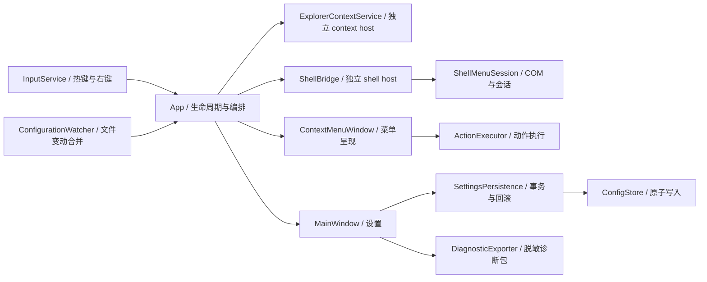

# BetterCM 当前架构

当前源码为 1.8.0，包含 2026-10-18 审查加固；历史发行记录不代表本次工作树已发布。

## 关键契约

- 主进程不加载第三方 Shell 扩展；context host 与 shell host 由有限生命周期的管道管理。Shell 会话、命令 ID 和 Explorer 视图一一绑定，旧上下文不得执行新目标。
- `_current`、`_spare` 和进行中的执行连接分别持有所有权；失败预热的关闭连接不能交给下一次菜单请求。超时不强杀正在处理系统操作的宿主。
- `MenuPresentationRequest` 承载呈现参数，生产入口使用具名字段；旧位置参数仅供内部夹具兼容。菜单窗口分出 Keyboard、NativeMenu、Submenus partial，各级菜单共用根生命周期。
- 程序名仅在设置时从绝对 PATH 项或 App Paths 解析。执行只接受现有 `.exe` / `.com` 的绝对路径，自定义动作默认使用程序目录作为 WorkingDirectory，只有显式启用 UseTargetWorkingDirectory 时才使用目标目录。内置系统程序使用系统目录；VS Code 可用性在进程中缓存。脚本应显式配置解释器及参数。
- 配置 schema 当前为 2。`ConfigMigrations` 按版本逐级迁移：v1 可解析程序名转成绝对路径，无法解析的动作保留并禁用；迁移仅在内存执行，显式保存后才更新磁盘并保留 `.bak`。未来版本和损坏配置拒绝保存，原文及损坏副本保留。
- 配置写入使用同目录临时文件、磁盘刷新和原子替换；保存前检测外部编辑。设置与自启项保持已有回滚语义。`ConfigurationWatcher` 合并高频文件事件并在 UI 线程重载。
- UI 动作事件局部记录异常；未知全局 UI 异常仍暂停右键接管。AppDomain 事件补充记录未处理托管异常；原生崩溃仍依赖 Windows 错误报告，不能宣称已捕获所有原生故障。
- 诊断包使用字段白名单，不复制原配置、异常消息或堆栈；菜单 UIA peer 提供菜单项角色、位置、总数及选中/勾选/禁用状态说明，仍需屏幕阅读器实测。
- NuGet 使用集中版本与锁文件，CI 以 locked mode 恢复并审计传递依赖。UI/Shell 门禁比较稳定 ID，显示名映射只提供辅助提示。
- 安装器发布仍要求干净提交和程序集提交标识匹配；签名为可选能力，`-RequireSigning` 强制签名并验证信任链和时间戳。跳过桌面验证的产物仅放入 `artifacts/internal`。

历史逐版设计说明见 [architecture history](docs/history/architecture.md)。工程操作与未完成的外部验证见 [审查实施记录](docs/current/REVIEW-IMPLEMENTATION.md)。
