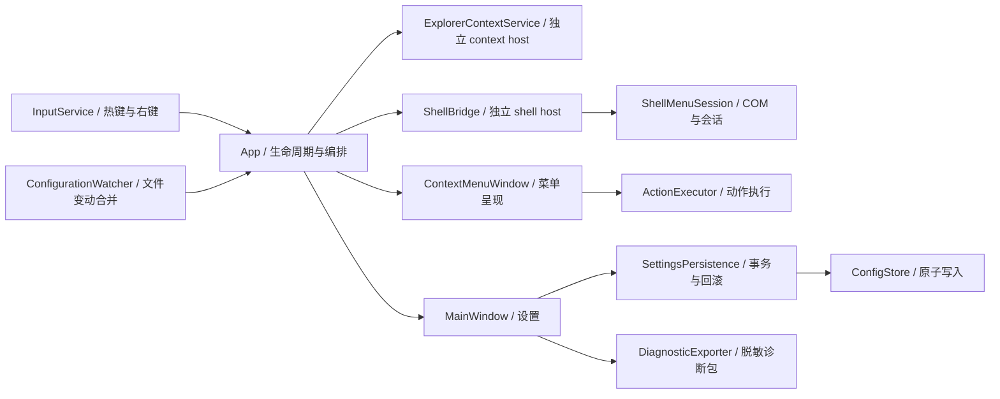

# BetterCM 当前架构

当前源码为 2.0.0。版本由 Version.props 集中定义；源码提交、构建产物及验证范围以对应候选或发布清单为准。历史发行记录不代表当前代码已验证或发布。

## 关键契约

- 主进程不加载第三方 Shell 扩展；context host 与 shell host 由有限生命周期的管道管理。Shell 会话、命令 ID 和 Explorer 视图一一绑定，旧上下文不得执行新目标。
- `_current`、`_spare` 和进行中的执行连接分别持有所有权；失败预热的关闭连接不能交给下一次菜单请求。超时不强杀正在处理系统操作的宿主。
- `MenuPresentationRequest` 承载呈现参数，生产入口使用具名字段；旧位置参数仅供内部夹具兼容。菜单窗口分出 Keyboard、NativeMenu、Submenus partial，各级菜单共用根生命周期。
- 程序名仅在设置时从绝对 PATH 项或 App Paths 解析。执行只接受现有 `.exe` / `.com` 的绝对路径，菜单构建时通过 CustomActionPresentation 检查自定义程序是否存在，缺失时禁用并显示原因，保留配置供介质恢复后重用。自定义动作默认使用程序目录作为 WorkingDirectory，只有显式启用 UseTargetWorkingDirectory 时才使用目标目录。内置系统程序使用系统目录；VS Code 可用性在进程中缓存。脚本应显式配置解释器及参数。
- 配置 schema 当前为 3。`ConfigMigrations` 按版本逐级迁移：v1 可解析程序名转成绝对路径，无法解析的动作保留并禁用；v2 增加默认不限制的规则和空分组，重分配与新命令冲突的自定义 ID。迁移仅在内存执行，显式保存后才更新磁盘并保留 `.bak`。未来版本和损坏配置拒绝保存，原文及损坏副本保留。
- 配置写入使用同目录临时文件、磁盘刷新和原子替换；保存前检测外部编辑。设置与自启项保持已有回滚语义。`ConfigurationWatcher` 合并高频文件事件并在 UI 线程重载；Error 事件记录异常、重建 watcher，失败后以两秒间隔重试。配置菜单快照采用手写深拷贝，保持集合比较器并隔离嵌套列表。
- UI 动作事件局部记录异常；未知全局 UI 异常仍暂停右键接管。AppDomain 事件补充记录未处理托管异常；原生崩溃仍依赖 Windows 错误报告，不能宣称已捕获所有原生故障。
- 诊断包使用字段白名单，不复制原配置、异常消息或堆栈；菜单 UIA peer 提供菜单项角色、位置、总数及选中/勾选/禁用状态说明，仍需屏幕阅读器实测。
- NuGet 使用集中版本与锁文件，CI 以 locked mode 恢复并审计传递依赖。UI/Shell 门禁比较稳定 ID，显示名映射只提供辅助提示。
- 安装器发布仍要求干净提交和程序集提交标识匹配；签名为可选能力，`-RequireSigning` 强制签名并验证信任链和时间戳。跳过桌面验证的产物仅放入 `artifacts/internal`。

历史逐版设计说明见 [architecture history](docs/history/architecture.md)。工程操作与未完成的外部验证见 [审查实施记录](docs/current/REVIEW-IMPLEMENTATION.md)。

## 生产与 QA 边界

- 默认 Release 不编译 `Services/*Checks.cs`、`SelfTests.cs`、`App.Diagnostics.cs`。Debug/QA 配置定义 QA 常量，测试项目显式引用 QA 配置，输出分目录。
- `StartupRouter` 限定生产参数；QA 参数路由集中在 App.Diagnostics partial。键盘记录、Shell 回调跟踪、性能钩子和 QA 自启项覆盖均以 QA 条件编译；正式发布后扫描程序集类型和 QA 字符串，并实际检查诊断入口返回码。
- `ActionCatalog.Ordered` 一次索引配置，保持首个重复 ID 优先和稳定排序；执行器按动作 ID 字典查找。参数占位符只遍历模板，插入的路径不参与第二次展开。
- Explorer/桌面请求在读取剪贴板前判别窗口类；只有非 Explorer 回退分支读取剪贴板。上下文 COM 捕获继续由独立进程和 1800 ms 预算保护。
- 自定义逐个启动使用独立 STA、并发度 1、进度与启动前取消检查，已启动进程不因取消而终止。
- 实例名称规则集中在 AppInstance；所有数据目录实例共持有安装占用标记，安装器检测自定义数据目录实例并要求正常退出。此标记不取代原有单实例锁。
- Shell 原生操作宿主仍等待活跃 UI/引用结束，15 秒后降低到每秒检查。没有采用强制最长存活时间，避免终止长时间文件操作。
- CI 安装阶段可复用验证回执；回执必须对应干净提交、版本、检查范围、唯一且完整的文件集合与所有哈希。

本轮范围见 [2.0.0 迭代说明](docs/releases/2.0.0/ITERATION-2.0.0.md)；此前取舍保留在各版迭代记录。

## 2.0.0 场景与文件整理

- ActionRules 在捕获的文件系统选区上计算目标类型、名称通配符、规范目录边界和数量，不访问文件系统。规则对整组选区生效，不悄悄移除不匹配项目；原生 Shell 目标与会话保持不变。
- 菜单方案只筛选增强动作；工具栏不受方案筛选。自动选择先比较全部目标是否处于方案目录内，再取最长规范目录匹配；同深度保持配置顺序。没有自动匹配时回退手动方案，空 ID 为默认全部动作。托盘切换通过现有设置事务与草稿 rebase。
- Group 作为一层呈现属性保存在内置偏好和自定义动作中，一级与“更多”分别分组，空组不会生成，搜索保留分组标题。ShellCommandMap 在绑定原生命令时保留配置分组，但不改变真实命令 ID 和 Execute。
- BatchRename 的预览、校验和内容指纹读取在 worker 执行。名称按原选区顺序计算，先查找替换／大小写，再前后缀和编号；阶段式同目录临时改名支持交换、循环和大小写变化。文件移动一律禁止覆盖。失败尝试恢复，恢复冲突保留路径并报告，不承诺跨掉电或进程终止的原子事务。
- 重命名窗口持有一次内存撤销记录；撤销前核对文件 SHA256／时间戳／大小、文件夹自身时间戳及原名称占用。没有递归快照文件夹内部内容，也没有持久化撤销日志。取消在校验和正向执行检查，恢复阶段不被取消打断。
- 收藏目录通过现有用户专用命名管道发送 copy-to / move-to 到独立 Shell 宿主。宿主再次校验目标、自包含目录和父子选区，按需创建日期子目录，使用 IFileOperation 提供冲突、进度、权限与系统撤销记录；主进程不实例化该 COM 对象。启动仍限时，传输完成等待不设置文件操作总超时，IPC 关闭不强杀正在执行的宿主。
- 动作交换格式 2 包含规则与分组，继续读取格式 1；方案和收藏目录仅在主配置内。诊断导出仍为字段白名单，不加入规则中的文件名、路径、收藏名称或方案内容。
- IFileOperation 契约参考 [微软接口说明](https://learn.microsoft.com/en-us/windows/win32/api/shobjidl_core/nn-shobjidl_core-ifileoperation) 和 [操作标志](https://learn.microsoft.com/en-us/windows/win32/api/shobjidl_core/nf-shobjidl_core-ifileoperation-setoperationflags)。

## 1.10.0 自定义动作

- CustomActionPlan 复制动作及选区，纯计算独立参数、目标目录、工作目录和启动次数，作为预览与执行的共同来源。执行仍在 STA worker 上串行启动，并逐次检查取消；程序存在性由实际启动阶段检查，预览不访问文件系统。
- CustomActionWindow 左侧编辑、右侧持续预览；示例或最近选区不会写入配置。模板只填充编辑草稿，原动作 ID 与启用状态保留，应用列表后仍需保存。
- CustomActionTransfer 使用独立的 Format/Version/Actions JSON 文档，版本 1 与 AppConfig schema 2 分开演进。限额为 1 MiB / 500 项；拒绝不支持格式、未知字段、重复动作 ID 和无效动作。读取、合并与导出均不解析程序名或启动程序。
- 重复项先按 ID，再按名称、程序、参数、选区模式、管理员与工作目录策略及扩展名集合比较；替换保留原 ID 和位置，保留两份时只对冲突 ID 重新分配。合并返回独立副本，确认后才更新设置草稿，保存仍走现有事务与冲突保护。
- 导出先校验与序列化，写同目录临时文件、刷新后替换目标。导入确认列出启动参数、管理员、目标工作目录及启用状态；经典模式可交换动作文件而不切换模式。

## 1.9.1 请求观测与探测隔离

- InputService 在接受右键松开及热键消息时附上 Stopwatch 时间戳；输入 hook 不写磁盘或日志。App 记录排队、上下文、Shell、动作、Show 后及 WPF Rendering 后观测的累计时间。只保留最近 32 次结束请求；取消、过期、关闭前未呈现、焦点未就绪和成功分别记录。
- 呈现观察器与菜单代次绑定，在关闭、隐藏、重开和失败时注销；未激活菜单不会报告键盘就绪。Rendering 后的观察值不是物理显示、动画完成或长期性能保证。
- 上下文捕获开始即注册准备期输入观察，外部输入、打开设置和预览均取消捕获及后续 Shell 请求，避免迟到菜单。
- ProgramAvailability 为本地与网络各保留四个名额。UNC、扩展 UNC 及 GetDriveType 识别的映射网络盘使用网络池；网络任务采用独立线程，失败/超时按路径退避两秒，记录上限 128。调用等待预算 250 ms 不变。不可取消的文件系统调用仍等待系统返回，但不能消耗本地池或共享线程池。
- verify 开始和完成时核对提交、脏状态及全部源码文件 SHA256；安装器复用回执时再次核对。发布目录同时保存载荷和源码清单、验证范围、包哈希。候选脚本在逐文件匹配的独立干净快照内运行同一流程，并保留精确字节源码 ZIP 与快照 Git bundle。

## 1.9.0 复查后的构建和维护策略

解决方案显式声明 Debug/Release/QA。Release 只构建产品；Debug/QA 构建测试。测试项目直接构建时仍固定引用 QA 产物。CodeQL 使用产品项目，verify 同时检查三个解决方案配置和 QA/Release 测试项目，避免项目级通过掩盖解决方案失败。

归档清理仅使用运行开始时的归档清单，在新归档创建之前执行；本次新归档不受清理预算影响，超额留待后续运行评估。BackupRoot 必须位于工作区外，不能包含工作区。历史 release/QA 资产继续保留，不自动按容量删除。

## 第三轮门禁与 watcher

NativeUi/C037 分离首次与稳定状态测量：首次一次、稳定五次，验证真正 Hold、有效正耗时、完成呈现与解除遮蔽，再计算中位数和 nearest-rank P95。预算分别为首次 <1000 ms、稳定中位数 <250 ms、P95 <500 ms；五次的 P95 即最大值。QA 数学辅助和测试仍排除在 Release 程序集中，生产只增加当前呈现是否真正 Hold 的观测标记，无动画重开明确返回 0 ms 并标记未 Hold。

ConfigurationWatcher 在构造期间创建失败时也安排两秒重试，实例持续存在；运行期恢复及退出竞态处理保持。ScriptFixture 分类同时匹配 fixture/storage 的失败目录，共享保留预算和归档清理规则。最新证据见第三轮稳定性修正记录。
